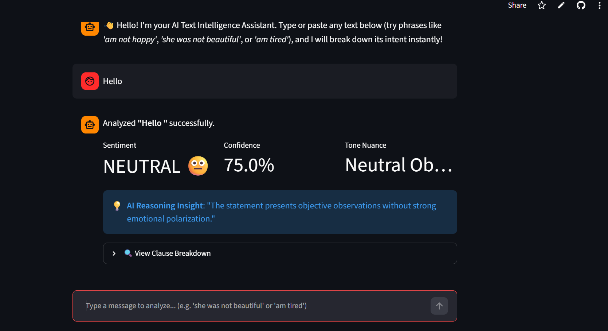
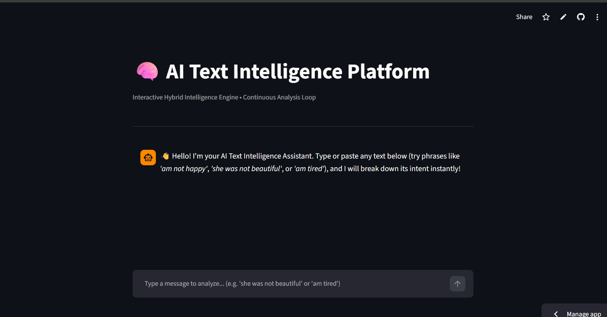

# 🧠 AI Text Intelligence Platform

<p align="center">
  
  
</p>

<p align="center">
  <a href="https://streamlit.io"></a>
  <a href="https://www.python.org"></a>
  <a href="https://github.com/temesgen-teka4/fastapi-sentiment-analyzer/blob/master/LICENSE"></a>
  <a href="https://github.com/temesgen-teka4/fastapi-sentiment-analyzer/stargazers"></a>
</p>

---

## 🚀 Overview
The **AI Text Intelligence Platform** is an interactive natural language analysis dashboard built with **Streamlit** and Python. It features a zero-latency **Hybrid Heuristic Intelligence Engine** designed to parse complex conversational semantics, sentence-level clause breakdowns, and informal tone nuances in real time.

---

## ✨ Key Features
- **Interactive Chat-Loop Interface:** Test multiple sentences sequentially in a continuous, conversational chat stream (`st.chat_input`).
- **Hybrid Heuristic Intelligence Engine:** Custom pattern-matching and regex ruleset engineered to detect negations (*"not beautiful"*), interpersonal rejections (*"don't want to see"*), counterfactual conditionals, and slang typos without external API latency or quota limits.
- **Clause-Level Breakdown:** Automatically segments complex sentences into isolated sub-clauses with confidence scoring and visual progress meters.
- **Robust State Management:** Powered by `st.session_state` with crash-proof dictionary handling to ensure smooth UI performance.

---

## 🛠️ Tech Stack
* **Frontend & Dashboard UI:** Streamlit
* **Core Rule Engine:** Python (Regex, Dynamic Dictionary Rulesets)
* **Deployment & Hosting:** Streamlit Community Cloud & GitHub

---

## 🚀 Local Installation & Quickstart

Get the project running locally in under 2 minutes:

1. **Clone the repository:**
   ```bash
   git clone [https://github.com/temesgen-teka4/fastapi-sentiment-analyzer.git](https://github.com/temesgen-teka4/fastapi-sentiment-analyzer.git)
   cd fastapi-sentiment-analyzer